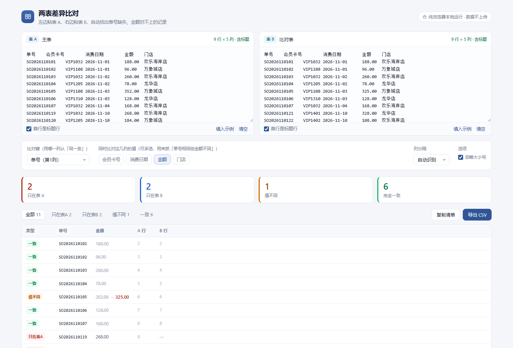

# 两表差异比对

**在线地址：<https://xtzl.github.io/two-table-diff/>**

把两张表分别粘进来，自动找出差异。纯前端单文件，零依赖，**数据不上传**。



## 能找什么

| 类型 | 含义 |
|---|---|
| **只在表 A** | A 有、B 没有 —— 对方漏了 |
| **只在表 B** | B 有、A 没有 —— 你这边漏了 |
| **值不同** | 单号对得上，但金额 / 日期 / 状态对不上 |
| **完全一致** | 两边都对得上 |

## 怎么用

1. 在 Excel 里选中区域 → `Ctrl + C`
2. 粘到左边输入框（表 A）
3. 另一张表粘到右边（表 B）
4. 结果实时出来，不需要点任何按钮

**几个省事的点：**

- 分隔符自动识别（制表符 / 逗号 / 分号 / 空格），识别不准可以手动改
- 标题行自动识别，识别错了取消勾选就行
- 比对键默认第一列，可以换成任意一列
- 勾选"同时比对这几列的值"，才能抓出**单号相同但金额不同**的情况
- 单号本身重复（一个单号挂多行明细）时，换成 `组合键：第1列 + 第2列`
- 结果右上角有**搜索框**，几百条里直接定位某条单号或某个时间
- 差异值会**逐字符高亮**，一眼看出是第几位不一样
- 粘贴的内容自动存在本机，误刷新、误关标签页不用重粘
- 结果可以一键复制（直接粘回 Excel），或导出 CSV

## 两种匹配模式

| 模式 | 行为 |
|---|---|
| **精确**（默认） | 比对键必须完全一致才算同一条 |
| **模糊** | 允许时间有 ±N 秒误差，自动把最接近的配成一对 |

**什么时候用模糊**：两个系统记录同一批操作时间，但服务器时钟有 1~2 秒偏差。比如表 A 记 `08:35:03`、表 B 记 `08:35:01`，精确模式会认为全都不匹配，模糊模式 ±5 秒就能对上。

几条保障：

- **按需出现**：只有比对键确实是时间数据时，「匹配模式」才会显示；换成单号、卡号时它自动隐藏，不干扰
- **误差自由填**：1~3600 秒随便输，不用迁就预设档位（客户系统差 37 秒也能填 40）
- **先精确后模糊**：时间完全一致的一定算「完全一致」，不会被误标成近似
- **一对一配对**：按时间差从小到大认领，一条 A 不会被两条 B 重复占用
- **只对时间有效**：单号、卡号等非时间数据即使切到模糊，也按精确比对
- **可追溯**：配对上的记录标为「近似 2s」，键列直接显示 `A 值 → B 值`，差异的那几位高亮

## 部署到 GitHub Pages

### 方式一：网页上传（不用装任何东西）

1. 打开 [github.com/new](https://github.com/new)，仓库名填 `two-table-diff`，选 **Public**，点 Create
2. 点 **Add file → Upload files**，把 `index.html` 和 `README.md` 拖进去，点 **Commit changes**
3. 进仓库 **Settings → Pages**
4. **Source** 选 `Deploy from a branch`，**Branch** 选 `main`、目录选 `/ (root)`，点 **Save**
5. 等 1~2 分钟，访问：

```
https://<你的GitHub用户名>.github.io/two-table-diff/
```

把这个网址存成手机浏览器书签，以后在客户现场直接打开就能用。

### 方式二：命令行

```bash
cd two-table-diff
git init
git add .
git commit -m "feat: 两表差异比对工具"
git branch -M main
git remote add origin https://github.com/<你的用户名>/two-table-diff.git
git push -u origin main
```

推上去之后，同样去 Settings → Pages 开启。

## 本地直接用

双击 `index.html` 就能打开，**不需要联网、不需要服务器**。可以拷到 U 盘带去客户现场。

## 判定规则

比对时会自动做这些归一化处理，**显示和导出仍保留你粘贴的原始内容**：

| 处理 | 说明 |
|---|---|
| 首尾噪音符号 | 自动去掉反引号 `` ` ``、单双引号、逗号、分号、顿号、竖线、星号、井号、句号等 |
| 时间格式 | 统一到秒：`2026/9/10 8:37:15` = `2026-09-10 08:37:15` = `2026年9月10日 08:37:15` = `2026.9.10T08:37:15.000` |
| 只到分钟的 | `2026-09-10 08:37` 按 `08:37:00` 处理 |
| 数字 | 按数值比：`188.00` = `188`，`¥1,234.00` = `1234` |
| 全角 / 大小写 | 全角转半角；可选忽略大小写 |
| 单号重复 | 会提示，只拿第一条配对，结果行带「重复」标记 |
| 空行 | 自动跳过，行号仍对应原始粘贴内容 |
| 键为空 | 该行跳过，并在顶部提示跳过了几行 |

**典型场景**：从系统导出的操作时间带反引号、日期用斜杠且不补零，另一张表用短横且补零——直接比对会全部不匹配，工具会自动统一成同一时刻来比对。

## 文件说明

```
index.html    整个工具（HTML + CSS + JS 全在里面）
README.md     本文件
```

没有构建步骤，没有 npm 依赖，改完直接刷新就能看到效果。

## 浏览器要求

Chrome / Edge / Safari 近几年版本都行。不支持 IE。

## 隐私

所有数据只在浏览器内存里处理，不上传任何服务器。断网也能正常用。

## 更新日志

- **v1.4.0** 2026-11-27 00:54 — 误差自由输入并按需显示、结果搜索、差异字符高亮、草稿自动保存
- **v1.3.0** 2026-11-27 00:47 — 页面显示版本号与构建时间，自动检测线上新版本
- **v1.2.0** 2026-11-27 — 新增精确 / 模糊两种匹配模式，支持时间 ±N 秒误差
- **v1.1.0** 2026-11-27 — 自动清洗首尾符号，统一时间格式
- **v1.0.0** 2026-11-26 — 初版

## 发版

改完功能后，在 `two-table-diff` 目录执行：

```bash
node release.js 1.3.1 "这次改了什么"
```

会自动更新页面上的版本号和时间、往更新日志插一条，然后提交推送。
